# ios-sim-mcp — Architecture

Architecture reference for the `ios-sim-mcp` server (repo: `projects/windsurf/mobile-automation`). It covers how the components talk to each other, the API contract at each boundary, the connection types, and request flows step by step.

Diagrams use Mermaid and render on GitHub, GitLab, VS Code (with a Mermaid extension) and most Markdown viewers.

> Where something is inferred rather than read directly from code, it is marked **(inferred)**.

---

## 1. System context

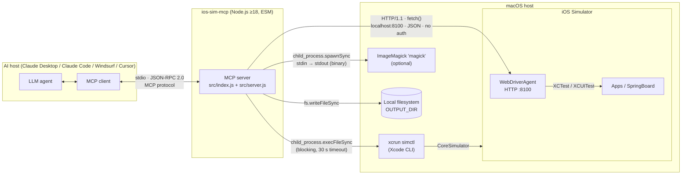

### Connection types

| # | From → To | Transport | Protocol / format | Sync model | Limits / settings | Source |
|---|---|---|---|---|---|---|
| C1 | MCP client ↔ server | Process stdio (stdin/stdout) | JSON-RPC 2.0, MCP (SDK `^1.6.1` in package.json, 1.11.3 installed; latest protocol `2025-03-26`) | Async, request/response | stderr is for logs; stdout is reserved for protocol | `src/index.js` |
| C2 | Server → `xcrun simctl` | Child process | CLI args → stdout (`Buffer`) | **Synchronous** (`execFileSync`), blocks the Node event loop | `timeout: 30000`, `maxBuffer: 4 MiB` | `src/iphone-simulator.js` |
| C3 | Server → WebDriverAgent | TCP, HTTP/1.1 to `localhost:8100` | W3C WebDriver + WDA extensions, JSON bodies | Async (`fetch`) | No auth, no TLS, no timeout, HTTP status not checked | `src/webdriver-agent.js` |
| C4 | Server → ImageMagick | Child process | PNG bytes on stdin → JPEG bytes on stdout | **Synchronous** (`spawnSync`) | `maxBuffer: 8 MiB` | `src/image-utils.js` |
| C5 | Server → filesystem | Local FS | Raw image bytes | Synchronous (`fs.writeFileSync`) | Path hard-coded in `OUTPUT_DIR` | `src/server.js` |
| C6 | WDA → apps | In-simulator | XCTest/XCUITest **(inferred, WDA internals)** | — | — | external |

---

## 2. Internal component and class view

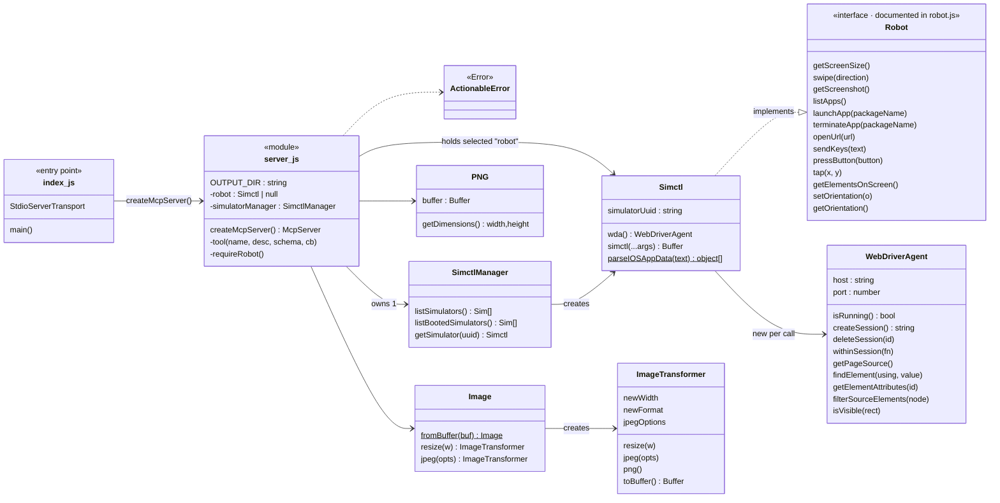

### Module responsibilities

| Module | Responsibility | Talks to |
|---|---|---|
| `src/index.js` | Builds `StdioServerTransport`, connects the server, logs `ios-sim-mcp server running on stdio` to stderr, exits 1 on fatal error. | `server.js` |
| `src/server.js` | Registers 15 MCP tools, holds the selected device (`robot`), wraps handlers with uniform error handling, runs the screenshot pipeline. | `iphone-simulator.js`, `png.js`, `image-utils.js`, FS |
| `src/robot.js` | Documents the Robot interface (comments only) and exports `ActionableError`, `ORIENTATIONS`, `BUTTONS`, `SWIPE_DIRECTIONS`. | — |
| `src/iphone-simulator.js` | `SimctlManager` discovers simulators. `Simctl` implements Robot: simctl for app lifecycle and screenshots, WDA for everything else. | `xcrun`, `webdriver-agent.js` |
| `src/webdriver-agent.js` | Thin HTTP client for WDA. Creates a short-lived WDA session for each operation. | WDA :8100 |
| `src/png.js` | Checks the PNG signature and reads width/height from the IHDR chunk (bytes 16–23). | — |
| `src/image-utils.js` | Detects ImageMagick and resizes/converts images through the `magick` CLI. | `magick` |

### Configuration constants (hard-coded)

| Constant | Value | File |
|---|---|---|
| `OUTPUT_DIR` | `/Users/harish.dewangan/Documents/ios-demo/` | `src/server.js` |
| `WDA_PORT` | `8100` (host `localhost`) | `src/iphone-simulator.js` |
| `TIMEOUT` | `30000` ms (simctl calls) | `src/iphone-simulator.js` |
| `MAX_BUFFER_SIZE` | `4 MiB` (simctl stdout) | `src/iphone-simulator.js` |
| `DEFAULT_JPEG_QUALITY` | `75` | `src/image-utils.js` |
| magick `maxBuffer` | `8 MiB` | `src/image-utils.js` |

---

## 3. Server state model

The server keeps exactly one piece of mutable state: the selected `robot`.

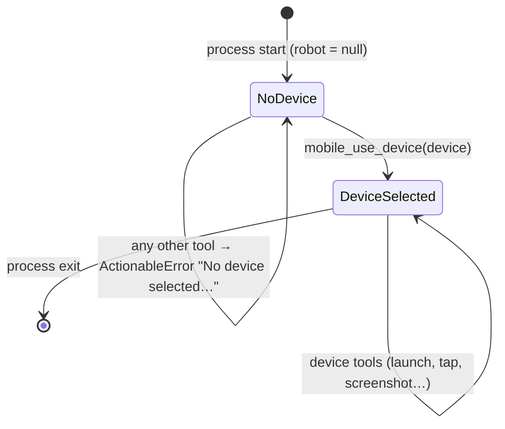

- `mobile_use_device` does **not** validate the identifier. It simply runs `new Simctl(device)`. Errors only appear later, when the first `simctl` or WDA call fails.
- State is per process. Every MCP client launches its own server process, so each has its own selection.

---

## 4. API contract — MCP layer (C1)

### 4.1 Transport and lifecycle

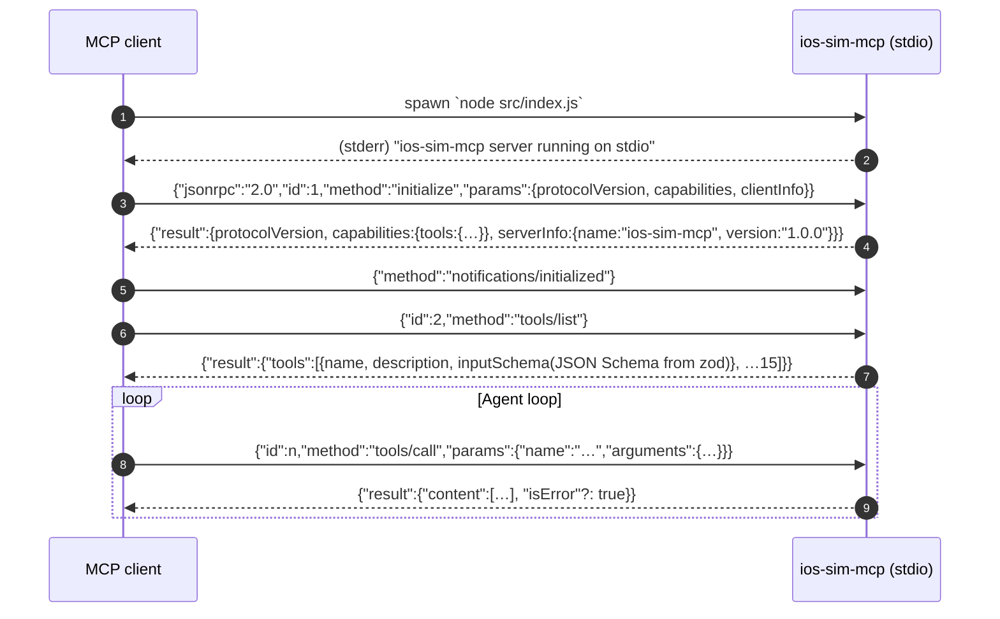

Note: `createMcpServer` places `capabilities` inside the first argument (`serverInfo`). In the installed SDK (1.11.3) the `McpServer` signature is `(serverInfo, options)`, so that field is not used as a capability declaration. The SDK registers the `tools` capability on its own when the first tool is registered (`registerCapabilities` in `sdk/dist/esm/server/mcp.js`).

### 4.2 Result envelope

| Case | Shape |
|---|---|
| Success (wrapped tools) | `{ content: [{ type: "text", text: <string> }] }` |
| `ActionableError` (wrapped tools) | `{ content: [{ type: "text", text: "<msg>. Please fix the issue and try again." }] }` (**no** `isError`) |
| Other exception (wrapped tools) | `{ content: [{ type: "text", text: "Error: <msg>" }], isError: true }` |
| Screenshot success | `{ content: [{ type: "image", data: <base64>, mimeType }, { type: "text", text: "Screenshot saved to <path>" }] }` |
| Screenshot error inside its `try` | `{ content: [{ type: "text", text: "Error: <msg>" }], isError: true }` |
| Screenshot with no device | `requireRobot()` throws before the `try` block. The SDK catches it and returns `{ content:[{type:"text", text:<msg>}], isError:true }` |

### 4.3 Tool contracts

| Tool | Input (zod → JSON Schema) | Robot call → backend | Success text |
|---|---|---|---|
| `mobile_list_available_devices` | `{ _unused: string }` (required, ignored) | `SimctlManager.listBootedSimulators()` → `simctl list devices -j` | `Found these devices:\niOS simulators: [A.B]` (names joined with `.`) |
| `mobile_use_device` | `{ device: string, deviceType: "simulator" }` | `getSimulator(device)`. No I/O. | `Selected device: <device>` |
| `mobile_list_apps` | `{}` | `listApps()` → `simctl listapps <udid>` | `Found these apps on device: Name (bundle), …` |
| `mobile_launch_app` | `{ packageName: string }` | `simctl launch <udid> <bundle>` | `Launched app <bundle>` |
| `mobile_terminate_app` | `{ packageName: string }` | `simctl terminate <udid> <bundle>` | `Terminated app <bundle>` |
| `mobile_get_screen_size` | `{}` | WDA `GET /session/:id/wda/screen` | `Screen size is WxH pixels` (WDA values, which are points) |
| `mobile_click_on_screen_at_coordinates` | `{ x: number, y: number }` | WDA `POST /session/:id/actions` (tap) | `Clicked on screen at coordinates: x, y` |
| `mobile_list_elements_on_screen` | `{}` | WDA `GET /source` + per-element lookups | `Found these elements on screen: <JSON array>` |
| `mobile_press_button` | `{ button: string }` | `ENTER` → `/wda/keys "\n"`; others → `POST /wda/pressButton` | `Pressed the button: <button>` |
| `mobile_open_url` | `{ url: string }` | WDA `POST /session/:id/url` | `Opened URL: <url>` |
| `swipe_on_screen` | `{ direction: "up" \| "down" }` | WDA `POST /session/:id/actions` (drag) | `Swiped <dir> on screen` |
| `mobile_type_keys` | `{ text: string, submit: boolean }` | WDA `POST /wda/keys`, then `pressButton("ENTER")` if `submit` | `Typed text: <text>` |
| `mobile_take_screenshot` | `{}` | WDA screen size + `simctl io screenshot -` + optional `magick` + FS write | image + text (see 4.2) |
| `mobile_set_orientation` | `{ orientation: "portrait" \| "landscape" }` | WDA `POST /session/:id/orientation` | `Changed device orientation to <o>` |
| `mobile_get_orientation` | `{}` | WDA `GET /session/:id/orientation` | `Current device orientation is <o>` |

#### Element object (`mobile_list_elements_on_screen`)

Each item merges three sources. Later keys win: `{ ...attributes, ...sourceNode, elementId }`.

| Field | Origin |
|---|---|
| `type`, `label`, `name`, `value`, `rawIdentifier`, `isVisible`, `rect{x,y,width,height}`, `children`… | WDA `/source?format=json` node **(field set inferred from WDA output; only `type`, `isVisible`, `rect`, `label`, `name`, `rawIdentifier`, `children` are read by the code)** |
| `elementId` | `POST /element` → `value.ELEMENT` (may be `undefined`) |
| other attribute keys | `GET /element/:id/attribute/all` → `value` |

Filter rules: `type ∈ {TextField, Button, Switch, Icon, SearchField, StaticText, Image, WebView, WebViewElement, WebViewElementContainer}`, `isVisible === "1"`, `rect.x ≥ 0 && rect.y ≥ 0`, and at least one of `label`/`name`/`rawIdentifier` is non-null. Children are always traversed recursively, whether or not the parent passes the filter.

---

## 5. API contract — WebDriverAgent HTTP (C3)

Base URL: `http://localhost:8100`. All bodies are JSON. The code only reads the fields listed in the response column.

| Purpose | Method & path | Request body | Response fields used | Caller |
|---|---|---|---|---|
| Health check | `GET /status` | — | HTTP `200` only | `isRunning()`. Runs before **every** robot→WDA call (`Simctl.wda()`). |
| Create session | `POST /session` | `{"capabilities":{"alwaysMatch":{"platformName":"iOS"}}}` | `value.sessionId` | `createSession()` |
| Delete session | `DELETE /session/:sid` | — | (parsed, ignored) | `deleteSession()` |
| Screen size | `GET /session/:sid/wda/screen` | — | `value.screenSize.width`, `value.screenSize.height`, `value.scale` (default 1) | `getScreenSize()` |
| Type text | `POST /session/:sid/wda/keys` | `{"value":["<text>"]}` | — | `sendKeys()` |
| Hardware button | `POST /session/:sid/wda/pressButton` | `{"name":"HOME"\|"VOLUME_UP"\|"VOLUME_DOWN"}` | (parsed, ignored) | `pressButton()` |
| Tap | `POST /session/:sid/actions` | W3C pointer: `pointerMove(x,y,0ms) → pointerDown → pause 100ms → pointerUp` | — | `tap()` |
| Swipe | `POST /session/:sid/actions` | W3C pointer: `pointerMove(200,y0) → pointerDown → pointerMove(200,y1,0ms) → pause 1000ms → pointerUp` | — | `swipe()` |
| UI tree | `GET /source/?format=json` (**no session**) | — | `value` (root node) | `getPageSource()` |
| Find element | `POST /session/:sid/element` | `{"using":"accessibility id","value":<rawIdentifier>}` | `value.ELEMENT` | `findElement()` |
| All attributes | `GET /session/:sid/element/:eid/attribute/all` | — | `value` | `getElementAttributes()`. **(Inferred: not a standard W3C/WDA route; support depends on the WDA build.)** |
| Open URL | `POST /session/:sid/url` | `{"url":"<url>"}` (no `Content-Type` header is sent) | — | `openUrl()` |
| Set orientation | `POST /session/:sid/orientation` | `{"orientation":"PORTRAIT"\|"LANDSCAPE"}` | — | `setOrientation()` |
| Get orientation | `GET /session/:sid/orientation` | — | `value` (lowercased) | `getOrientation()` |

Swipe coordinates: `down` → y0=600, y1=200 (finger moves up, so content scrolls down). `up` → y0=200, y1=600.

### 5.1 Session-per-call pattern

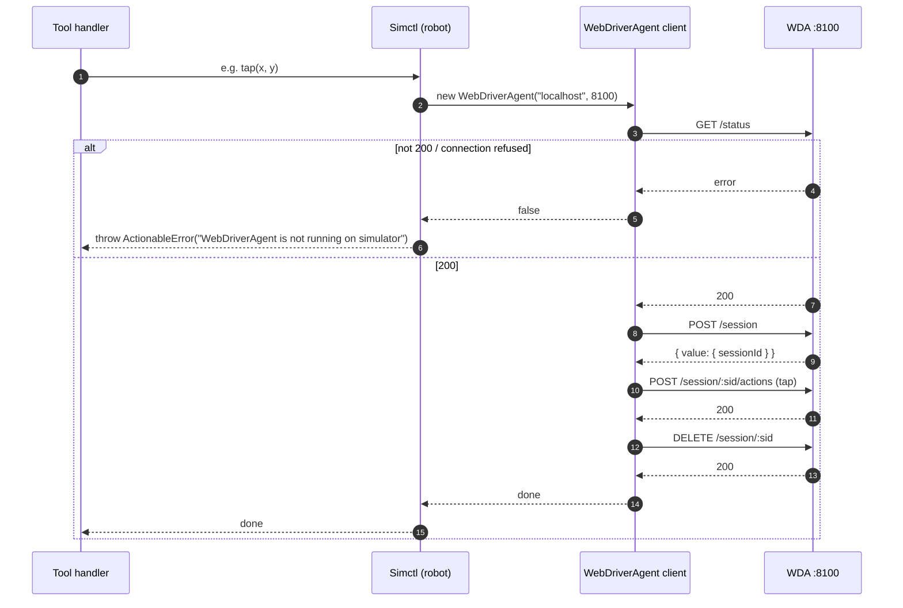

**Cost:** each simple WDA tool makes **4 HTTP round-trips** (status, create, operation, delete). If the operation throws, `withinSession` has no `try/finally`, so the session is **not deleted**.

---

## 6. API contract — `xcrun simctl` (C2)

| Purpose | Command | Output handling |
|---|---|---|
| Discover simulators | `xcrun simctl list devices -j` | JSON → `Object.values(json.devices).flat()` → `{name, uuid: udid, state}`, filtered to `state === "Booted"`. Skipped (returns `[]`) when `process.platform !== "darwin"`. Errors are logged and return `[]`. No timeout/maxBuffer options. |
| Screenshot | `xcrun simctl io <udid> screenshot -` | Raw PNG bytes on stdout (`Buffer`) |
| Launch | `xcrun simctl launch <udid> <bundleId>` | ignored |
| Terminate | `xcrun simctl terminate <udid> <bundleId>` | ignored |
| List apps | `xcrun simctl listapps <udid>` | Old-style plist text → `parseIOSAppData()` state machine → `{packageName: CFBundleIdentifier, appName: CFBundleDisplayName}` |

### 6.1 `parseIOSAppData` state machine

```mermaid
stateDiagram-v2
    [*] --> LOOKING_FOR_APP
    LOOKING_FOR_APP --> IN_APP : line matches  "bundle.id" = {
    IN_APP --> LOOKING_FOR_APP : line == "};"  (push app)
    IN_APP --> IN_APP : line matches  Key = Value;  (store prop)
    IN_APP --> IN_PROPERTY : line ends with "{"  (nested dict)
    IN_PROPERTY --> IN_APP : line == "};"
    IN_PROPERTY --> IN_PROPERTY : any other line (skipped)
```

The regex literals use `\\s` (a literal backslash followed by `s`) where `\s` was intended, so the transitions out of `LOOKING_FOR_APP` and the property match will probably never fire. `listApps` is then likely to return `[]`.

---

## 7. Key request flows

### 7.1 Device discovery and selection

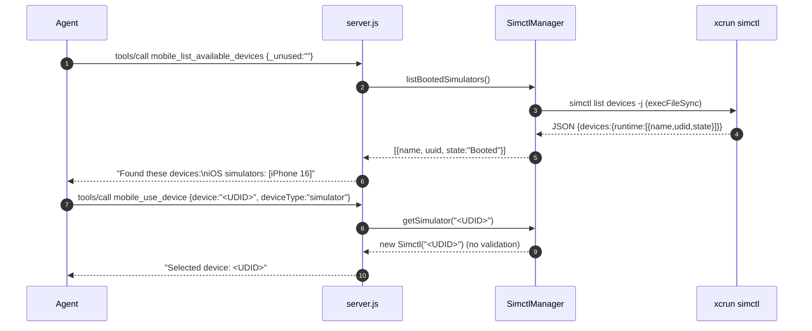

> The listing returns **names**, but `Simctl` passes `device` to `simctl` as the device identifier. Use the UDID (or `booted`).

### 7.2 Screenshot pipeline

```mermaid
sequenceDiagram
    autonumber
    participant A as Agent
    participant S as server.js
    participant R as Simctl
    participant D as WDA :8100
    participant X as xcrun simctl
    participant P as PNG
    participant I as magick
    participant F as Filesystem

    A->>S: tools/call mobile_take_screenshot {}
    S->>S: requireRobot()
    S->>R: getScreenSize()
    R->>D: /status, POST /session, GET /wda/screen, DELETE /session
    D-->>R: {width, height, scale}
    S->>R: getScreenshot()
    R->>X: simctl io <udid> screenshot -
    X-->>S: PNG Buffer
    S->>P: new PNG(buf).getDimensions()
    alt bad signature or 0 size
        P-->>S: throw → isError result
    end
    S->>I: magick --version (detect)
    opt ImageMagick installed
        S->>I: spawnSync magick - -resize {pngWidth/scale}x -quality 75 jpg:-
        I-->>S: JPEG Buffer (mimeType = image/jpeg)
    end
    S->>F: mkdir -p OUTPUT_DIR; write screenshot-<ISO-ts>.png
    S-->>A: [{type:image, data:base64, mimeType}, {type:text, "Screenshot saved to …"}]
```

Details:
- The output is resized to **point** resolution (`pngWidth / scale`), so on a 3× device the width drops to one third.
- The saved file is always named `.png`, even when its contents are JPEG.
- ImageMagick detection (`magick --version`) runs on every screenshot.

### 7.3 UI element listing (fan-out)

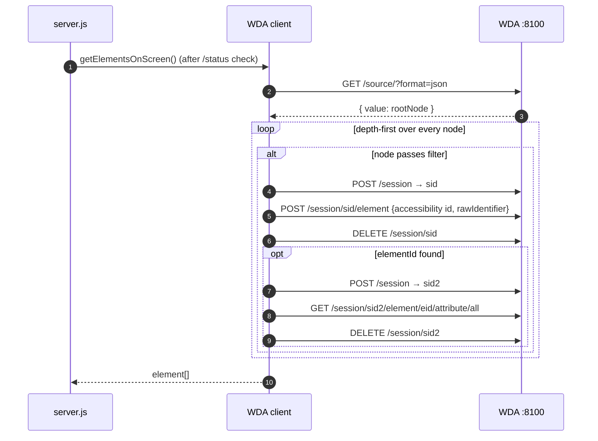

**Cost:** `2 + 3–6 × (matching elements)` HTTP calls, all run one after another. Screens with many elements can be slow. `findElement` also runs when `rawIdentifier` is `null` (the filter only needs one of label/name/rawIdentifier).

### 7.4 Typing with submit

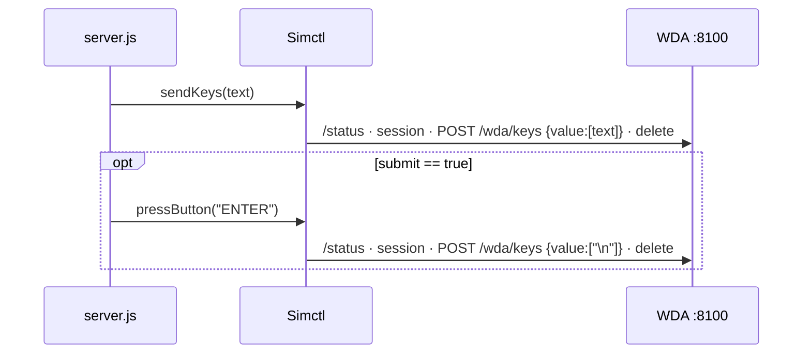

---

## 8. Error-handling architecture

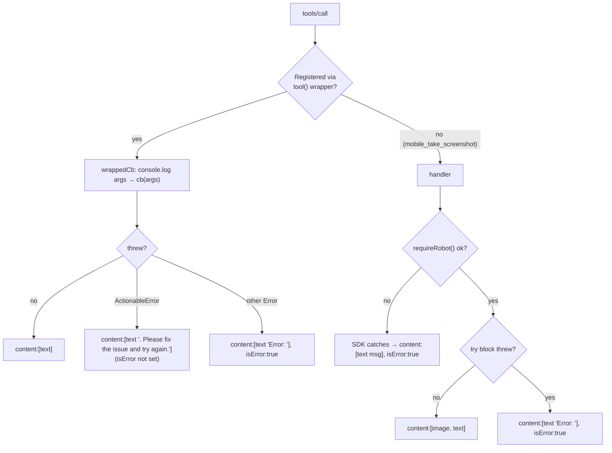

Error sources:

| Source | Raised as | Example |
|---|---|---|
| No device selected | `ActionableError` | `No device selected. Use the mobile_use_device tool to select a device.` |
| WDA not reachable | `ActionableError` | `WebDriverAgent is not running on simulator` |
| Unsupported button | `ActionableError` | `Button "BACK" is not supported` |
| Invalid screenshot | `ActionableError` (caught by the screenshot `try`, so it is returned with `isError:true`) | `Screenshot is invalid. Please try again.` |
| simctl non-zero exit / timeout | `Error` from `execFileSync` | `Command failed: xcrun simctl launch …` |
| WDA JSON shape mismatch | `TypeError` | `Cannot read properties of undefined (reading 'sessionId')` |
| Zod validation of arguments | Handled by the SDK before the handler runs **(inferred from SDK behaviour)** | — |

WDA non-2xx responses are **not** detected (`response.ok` is never checked). Failures only show up when a later JSON field access throws.

---

## 9. Deployment view

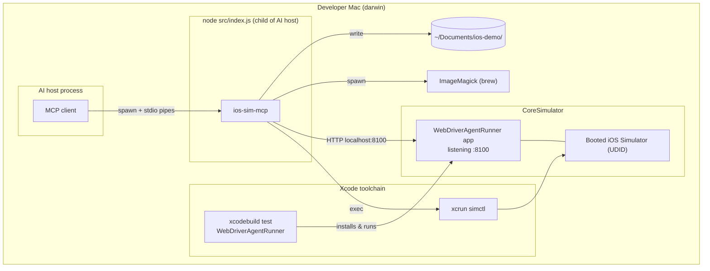

Notes:
- Simulators share the Mac's network stack, so WDA on the simulator is reachable at `localhost:8100` with no port forwarding.
- Only **one** WDA endpoint is supported. With several booted simulators, all WDA calls go to whichever WDA owns port 8100, whatever UDID was selected. simctl calls still go to the selected UDID, so the two channels can end up pointing at different simulators.

---

## 10. Architectural risks and gaps (from the code)

| Area | Observation | Impact |
|---|---|---|
| stdio hygiene | `console.log` in the tool wrapper, element listing and screenshot handler writes to **stdout**, which is the MCP protocol channel. | Clients may hit JSON-RPC parse errors. |
| Device identity | The listing returns names, but selection expects a UDID. No validation. | Confusing for agents. Failures happen late. |
| Multi-simulator | WDA host/port is fixed. | WDA and simctl actions can target different simulators. |
| Blocking I/O | `execFileSync` / `spawnSync` block the event loop for up to 30 s. | The server can't respond to anything else while a call is blocked. |
| WDA sessions | A session is created per call, and none is deleted when an error occurs. | Latency, plus possible leaked sessions. |
| Element listing | Sequential N+1 HTTP fan-out. | Slow on complex screens. |
| `pressButton` | Validates against `_map` but sends the original uppercase name (`"HOME"`) instead of the mapped value (`"home"`). | May be rejected depending on how WDA parses button names. |
| `listApps` | Regex escaping bug (`\\s`). | Probably returns an empty list. |
| HTTP robustness | No timeouts, no status checks. | Hangs or obscure `TypeError`s. |
| Config | `OUTPUT_DIR`, WDA port and timeouts are hard-coded. | Not portable to other machines. |
| Screenshot | Saved as `.png` even when JPEG. Payload size is capped by simctl `maxBuffer` (4 MiB). | Misleading files. Possible buffer overflow on very high-resolution devices **(inferred)**. |
| Dependencies | `zod` is imported but not declared. | Breaks if the SDK stops depending on it. |
| Capabilities | `capabilities` is passed inside `serverInfo`. | Harmless (the SDK auto-registers), but misleading. |
